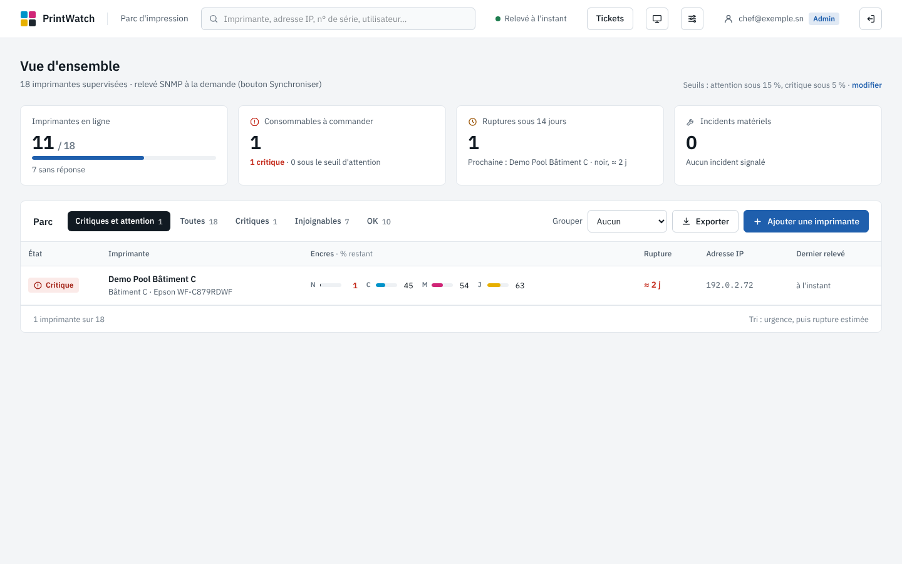
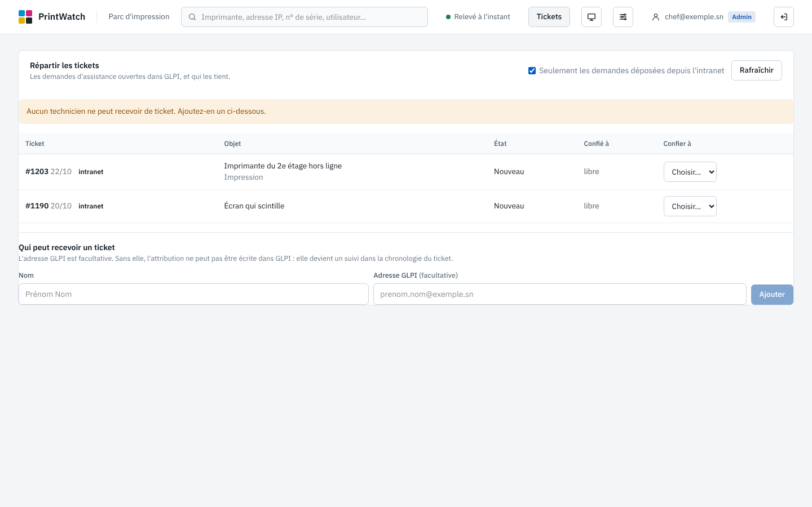
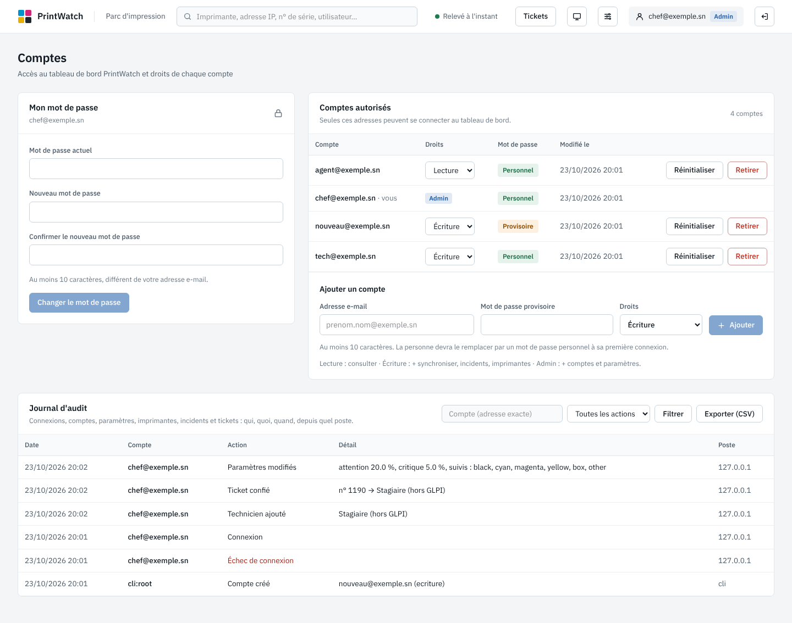
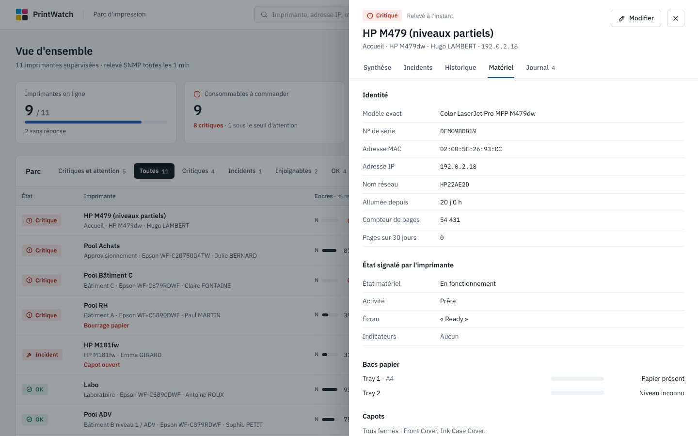
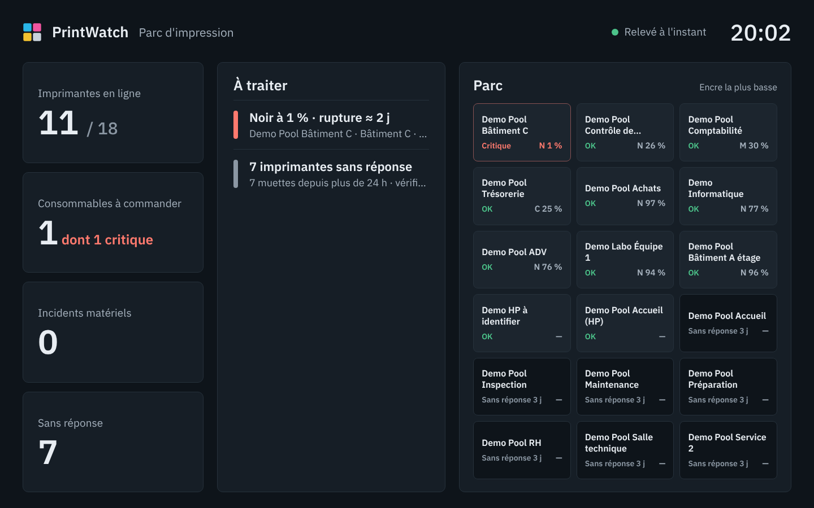
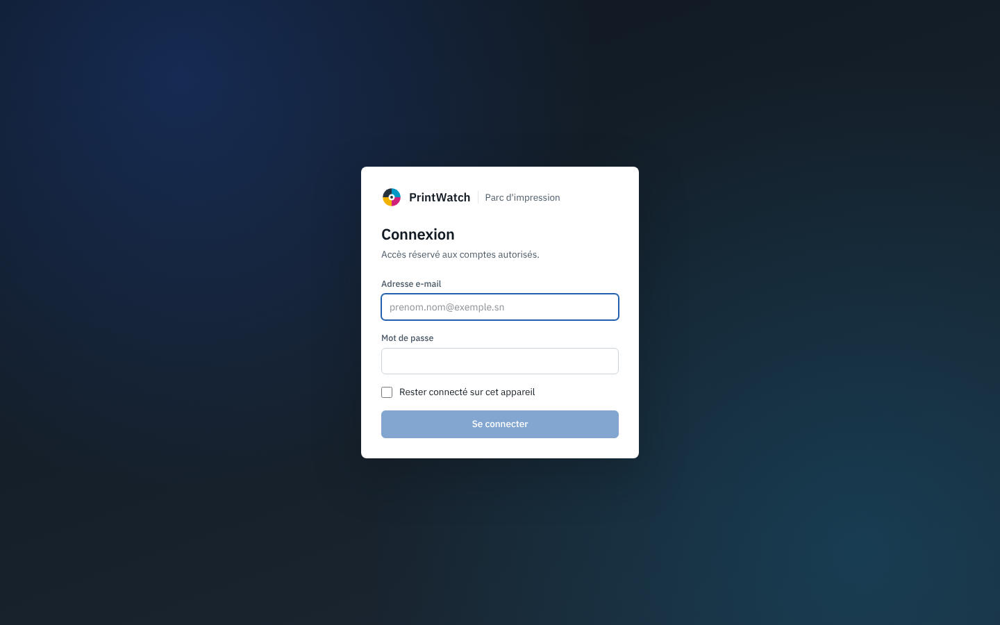

# PrintWatch (IT-MANAGER)

**Outil du service informatique** pour superviser le parc d'impression et répartir les demandes d'assistance :
niveaux d'encre et de toner, boîtiers de maintenance, état matériel des imprimantes, incidents, alertes par courriel,
prévision de rupture, et répartition des tickets GLPI entre les techniciens. Lecture des imprimantes en SNMP (Printer MIB, RFC 3805).

> Cœur Python **sans dépendance** (bibliothèque standard, y compris le client GLPI et le coffre de secrets) ; le tableau de bord ajoute
> FastAPI, pydantic et uvicorn ; l'interface est une application React compilée et livrée dans le dépôt (**Node.js n'est pas nécessaire
> pour l'exécuter**). Version **0.13.0** : durcissement de sécurité et journal d'audit (voir [§20](#20-historique)).

---

## Sommaire

1. [Fonctionnalités](#1-fonctionnalités)
2. [Architecture](#2-architecture)
3. [Prérequis](#3-prérequis)
4. [Démarrage rapide](#4-démarrage-rapide)
5. [Mode démonstration](#5-mode-démonstration)
6. [Configuration](#6-configuration)
7. [Ligne de commande](#7-ligne-de-commande)
8. [Comptes, rôles et sessions](#8-comptes-rôles-et-sessions)
9. [Le tableau de bord](#9-le-tableau-de-bord)
10. [Répartition des tickets (GLPI)](#10-répartition-des-tickets-glpi)
11. [La collecte et les alertes](#11-la-collecte-et-les-alertes)
12. [API HTTP](#12-api-http)
13. [Modèle de données](#13-modèle-de-données)
14. [Sécurité](#14-sécurité)
15. [Déploiement](#15-déploiement)
16. [Exploitation](#16-exploitation)
17. [Développement et tests](#17-développement-et-tests)
18. [Dépannage](#18-dépannage)
19. [Limites connues et points ouverts](#19-limites-connues-et-points-ouverts)
20. [Historique](#20-historique)

| Vue d'ensemble | Répartition des tickets | Comptes et journal d'audit |
|---|---|---|
|  |  |  |
| **Onglet Matériel** | **Écran mural** | **Connexion** |
|  |  |  |

*Captures réalisées sur des données fictives (mode démonstration et base de démonstration).*

---

## 1. Fonctionnalités

**Supervision du parc**
- Lecture SNMP **v1, v2c et v3** (`snmpwalk` / `snmpget` de net-snmp) de la table des consommables, pour toutes les marques qui respectent la Printer MIB.
- **Fiche matérielle** à chaque relevé : modèle exact, numéro de série, nom réseau, adresse MAC, durée de fonctionnement, compteur de pages, état
  (`En fonctionnement`, `Prête`…), indicateurs d'erreur (bourrage, capot ouvert, papier…), texte affiché sur l'écran, bacs papier, capots, alertes de l'imprimante.
- **Complément HP** : niveaux SNMP « inconnus » comblés par l'interface web de l'imprimante (LEDM).
- **Compteur de pages** historisé et **pages imprimées sur 30 jours** : onglet Matériel et export CSV du tableau.

**Alertes**
- Machine à états par consommable (attention, critique, résolu) avec hystérésis ; détection des **remplacements** et de l'**injoignabilité**.
- **Seuils et consommables suivis réglables depuis l'interface** (page Paramètres), relus à chaque cycle.
- Un **courriel de synthèse** par cycle (SMTP) ou, sans SMTP, une écriture dans les journaux.
- **Prévision de rupture** (régression linéaire depuis le dernier remplacement).

**Interface**
- **Vue d'ensemble** : quatre indicateurs (imprimantes en ligne, consommables à commander, ruptures sous 14 jours, incidents matériels) et un **tableau du parc** filtrable, groupable, exportable.
- **Volet de détail** par imprimante, en cinq onglets : Synthèse, Incidents, Historique, Matériel, Journal.
- **Incidents** déclarés à la main sur une imprimante, avec auteur, date et résolution.
- **Écran mural** (`#/mur`) pour la salle informatique : thème sombre, horloge, liste « À traiter », session prolongée automatiquement.
- **Comptes et rôles** (`lecture`, `ecriture`, `admin`), changement de son mot de passe, gestion des comptes depuis l'interface.
- **Journal d'audit** : connexions, comptes, paramètres, imprimantes, incidents, tickets ; filtrable, exportable en CSV (administrateurs).
- **Répartition des tickets GLPI** : liste des demandes ouvertes, qui les tient, attribution à un technicien (avec ou sans compte GLPI).

**Exploitation**
- Import / export CSV tolérants aux exports Excel ; mode démonstration sans imprimante ; diagnostic d'installation ; matrice de compatibilité.
- Déploiement **Windows Server + IIS** (script fourni), **Linux systemd** ou **Docker Compose**.

---

## 2. Architecture

```
 ┌─────────────┐  SNMP (UDP 161)          ┌──────────────────────────────┐        ┌───────────────────────────┐
 │ Imprimantes │ ◀─────────────────────── │  Collecteur                  │        │  API FastAPI + interface  │
 │             │  HTTP(S) LEDM (HP seul)  │  consommables, fiche         │        │  React (fichiers locaux)  │
 └─────────────┘                          │  matérielle, alertes         │        │  session par cookie signé │
                                          └──────────────┬───────────────┘        └──────┬──────────┬─────────┘
                                                         │ écrit                         │ lit/écrit│ HTTPS (OAuth 2.0)
                                                         ▼                               │          ▼
                                    ┌───────────────────────────────────────┐            │   ┌──────────────┐
                                    │ SQLite (WAL) : parc, relevés,          │◀───────────┘   │ GLPI 11      │
                                    │ événements, incidents, techniciens,    │                │ (api.php/v2) │
                                    │ attributions, réglages                 │                └──────────────┘
                                    └───────────────────────────────────────┘
                         data/users.json : comptes (empreintes scrypt) + clé de signature des cookies
                         .secrets.enc    : coffre DPAPI (Windows) des secrets GLPI
```

| Composant | Fichier | Rôle |
|---|---|---|
| Client SNMP | `printwatch/snmp.py` | `snmpwalk` / `snmpget` ; secrets dans un `snmp.conf` temporaire (0600), jamais en ligne de commande |
| Fiche matérielle | `printwatch/device.py` | Host Resources MIB + Printer MIB : série, compteur, état, erreurs, bacs, capots, alertes, MAC |
| Normalisation | `printwatch/normalize.py` | Table brute → consommables (couleur, type, pourcentage, valeurs spéciales, réceptacles inversés) |
| Complément HP | `printwatch/ledm.py` | Lit `/DevMgmt/ConsumableConfigDyn.xml` pour combler les niveaux SNMP inconnus |
| Alertes | `printwatch/alerts.py` | Machine à états, seuils, consommables suivis (`AlertSettings`) |
| Prévision | `printwatch/forecast.py` | Rupture estimée et indice de confiance |
| Collecteur | `printwatch/collector.py` | Un cycle : interrogation parallèle, relance, événements, notification, purge |
| Synchronisation | `printwatch/sync.py` | Bouton « Synchroniser » → un cycle immédiat, sans martelage |
| Stockage | `printwatch/storage.py` | SQLite (WAL), schéma et migrations automatiques |
| Notifications | `printwatch/notify.py` | Courriel SMTP ou journal |
| Comptes | `printwatch/auth.py` | Comptes, rôles, scrypt, cookie signé HMAC-SHA256, blocage après échecs |
| GLPI | `printwatch/glpi.py` | Client GLPI 11 (OAuth 2.0, API v2) : lister, voir l'attributaire, attribuer, écrire un suivi |
| Coffre de secrets | `printwatch/secrets_vault.py` | Secrets chiffrés par DPAPI (Windows, portée machine) |
| API et interface | `printwatch/web.py`, `printwatch/static/` | API JSON, contrôle d'accès, page unique |
| CLI | `printwatch/cli.py` | Toutes les commandes ([§7](#7-ligne-de-commande)) |
| Démo | `printwatch/demo.py` | Parc fictif et relevés simulés |
| Interface (source) | `frontend/` | React 19 + TypeScript + Tailwind 4 ; build commité dans `printwatch/static/` |

**La base fait foi** pour la liste des imprimantes : elle se modifie depuis l'interface. Le CSV ne sert qu'à **amorcer** une base vide, à **importer** et à **exporter**.

---

## 3. Prérequis

| Élément | Détail |
|---|---|
| Python | **3.11 ou plus récent** (CI : 3.11 et 3.12) |
| net-snmp | `snmpwalk` et `snmpget` : `sudo apt install snmp` (Linux / WSL) ; sous Windows, installateur net-snmp (chemins à déclarer dans `[snmp]`). **Inutile en mode démo** |
| Réseau | UDP/161 du serveur vers les imprimantes ; HTTP(S) vers les HP (LEDM) ; HTTPS vers le serveur GLPI si la répartition des tickets est utilisée |
| Extras Python | `web` (FastAPI, pydantic, uvicorn) pour le tableau de bord ; `dev` pour les tests |
| Coffre de secrets | **Windows uniquement** (DPAPI). Sous Linux, les secrets GLPI se lisent dans l'environnement |
| Navigateur | Chrome, Edge, Firefox ou Safari récents |

---

## 4. Démarrage rapide

```bash
# 1. Environnement
sudo apt install snmp
python3 -m venv .venv && . .venv/bin/activate
pip install -e ".[web]"                        # ".[dev]" pour lancer aussi les tests
pytest -q                                      # (avec .[dev]) attendu : 276 passed

# 2. Fichiers de travail (aucun n'est versionné)
cp config.example.toml config.toml             # version SNMP, seuils, SMTP, intervalle, GLPI
cp printers.example.csv printers.csv           # liste d'amorçage
cp .env.example .env && chmod 600 .env         # secrets SNMP / SMTP
set -a; . ./.env; set +a

# 3. Une imprimante, sans rien écrire
printwatch probe 192.0.2.10

# 4. Le premier compte : un ADMINISTRATEUR (le rôle par défaut est « ecriture »), mot de passe saisi au clavier
printwatch users add --role admin prenom.nom@exemple.sn

# 5. Tableau de bord + collecte dans un seul processus
printwatch serve --collect -p printers.csv     # http://localhost:8080
```

> **Le premier compte doit être créé avec `--role admin`** : sans administrateur, personne ne peut gérer les comptes ni les paramètres depuis
> l'interface (rattrapage : `printwatch users role admin <adresse>`).

Autres modes : `printwatch once` (un cycle puis arrêt), `printwatch loop` (collecte seule, en continu), `printwatch serve` (tableau de bord seul, sans collecte ni bouton Synchroniser).

---

## 5. Mode démonstration

```bash
printwatch serve --demo                # http://localhost:8080
```

- **Parc fictif**, relevés simulés (un cycle par minute), **fiches matérielles** simulées : tout l'interface est visible, onglet Matériel compris.
- **Sans connexion** (aucun compte), sans net-snmp, sans réseau, **aucun fichier de configuration lu**. Base jetable `demo.db` recréée à chaque lancement.
- La répartition des tickets n'est pas disponible en démo (GLPI non configuré).
- Sous Windows : `powershell -ExecutionPolicy Bypass -File .\tools\demo.ps1 [-Port 8080]` (crée `.venv-demo`, installe, ouvre le navigateur).

Pour une démonstration **avec comptes** et 30 jours d'historique : `python tools/seed_demo.py data/demo.db --profile audit`, une config pointant
`db_path` vers cette base, puis `printwatch users add …` et `printwatch serve`.

---

## 6. Configuration

### 6.1 `config.toml`

Aucun secret dans ce fichier. Par défaut `config.toml` du dossier courant, sinon `-c chemin`. Une clé ou une section inconnue est refusée.

| Section | Clé | Défaut | Rôle |
|---|---|---|---|
| `[snmp]` | `version` | `"3"` | `"1"`, `"2c"` ou `"3"` |
| | `user`, `level` | `""`, `authPriv` | Compte SNMPv3 (obligatoire en v3) ; `noAuthNoPriv`, `authNoPriv`, `authPriv` |
| | `auth_proto`, `priv_proto` | `SHA`, `AES` | Protocoles v3 |
| | `context` | `""` | Contexte v3 (simulateur seulement) |
| | `timeout`, `retries`, `command_timeout` | `3.0`, `1`, `30.0` | Par requête, relances, durée maximale d'un `snmpwalk` |
| | `snmpwalk`, `snmpget` | `snmpwalk`, `snmpget` | Chemins des binaires (Windows : chemins complets) |
| `[thresholds]` | `warn`, `crit` | `15.0`, `5.0` | Seuils en % restant ; **valeurs par défaut**, la page Paramètres prime dès qu'elle est enregistrée |
| | `hysteresis` | `5.0` | Marge avant de considérer une alerte résolue (courriels) |
| `[smtp]` | `host`, `port`, `starttls` | `""`, `25`, `false` | Vide : alertes dans les journaux. Port 465 : TLS implicite |
| | `user` | `""` | Si renseigné, mot de passe obligatoire dans `PRINTWATCH_SMTP_PASSWORD` |
| | `sender`, `recipients` | | Expéditeur, destinataires |
| `[collector]` | `db_path` | `printwatch.db` | Base SQLite ; **`users.json` est créé dans le même dossier** |
| | `interval_s` | `1800` | Secondes entre deux cycles ; `0` : synchronisation manuelle uniquement (`serve --collect`) |
| | `workers`, `down_after` | `8`, `3` | Interrogations parallèles ; échecs consécutifs avant « injoignable » |
| | `replacement_jump` | `20.0` | Hausse (points) lue comme un remplacement |
| | `retention_days` | `400` | Conservation des relevés, cycles, compteurs et événements notifiés |
| | `hp_ledm`, `retry_delay_s` | `true`, `3.0` | Complément HP ; relance unique des échecs dans le cycle |
| `[glpi]` | `url` | `""` | `https://glpi.exemple.sn/api.php`, **sans `/v2`**. Vide : onglet Tickets inactif (`503`) |
| | `client_id`, `username` | `""` | Client OAuth 2.0 déclaré dans GLPI ; compte de service |
| | `timeout` | `10.0` | Secondes par appel GLPI |
| | `marqueurs_intranet` | `["deposee depuis", "intranet"]` | Fragments (tous exigés) qui signent une demande déposée depuis l'intranet ; comparés sans accents, sans casse, entités HTML décodées. Y écrire la phrase de pied de page de **votre** intranet |
| | `entity_id`, `category_id`, `request_type_id`, `type_ticket` | | Acceptés mais **non utilisés** par le code actuel ([§19](#19-limites-connues-et-points-ouverts)) |
| | `client_secret_key`, `password_key` | `GLPI_CLIENT_SECRET`, `GLPI_PASSWORD` | **Noms** des deux secrets (coffre, sinon environnement) |

### 6.2 Secrets

| Secret | Où |
|---|---|
| `PRINTWATCH_SNMP_COMMUNITY` (v1/v2c), `PRINTWATCH_SNMP_AUTH_PASS`, `PRINTWATCH_SNMP_PRIV_PASS` (v3) | Environnement (`.env`) |
| `PRINTWATCH_SMTP_PASSWORD` | Environnement |
| `GLPI_CLIENT_SECRET`, `GLPI_PASSWORD` | **Coffre DPAPI** (`printwatch secret set …`, Windows) ; à défaut, variables d'environnement de même nom |

Autres variables : `PRINTWATCH_ALLOWED_HOSTS` (noms acceptés dans l'en-tête `Host`, [§14](#14-sécurité)), `PRINTWATCH_USERS_FILE` (fichier des comptes,
défaut `users.json` à côté de la base), `PRINTWATCH_VAULT_PATH` (emplacement du coffre, défaut `.secrets.enc` à la racine du dépôt),
`PRINTWATCH_ADMIN_TOKEN` (**mode démo seulement** ; ignoré dès qu'il y a des comptes).

La CLI ne lit pas `.env` : le charger dans le shell (`set -a; . ./.env; set +a`), ou laisser le service le faire (systemd `EnvironmentFile`, script Windows).

### 6.3 Liste d'imprimantes (CSV)

```csv
id,name,host,brand,model,location,user,enabled
epson-compta-1,Compta-1,192.0.2.10,Epson,WF-C879R,Bureau 12,Prénom NOM,1
```

Seuls `id` et `host` sont obligatoires. UTF-8 ou ANSI, séparateur `,` `;` ou tabulation, en-têtes insensibles à la casse ; `enabled` accepte `1/0`, `oui/non`,
`vrai/faux` (toute autre valeur est refusée) ; adresse validée, adresse en double refusée.

---

## 7. Ligne de commande

```text
printwatch [-c CONFIG] [-v] [--version] <commande> [options]
```

| Commande | Rôle |
|---|---|
| `probe HOTE` | Lit **une** imprimante, sans rien écrire |
| `once [-p CSV]` / `loop [-p CSV]` | Un cycle puis arrêt / collecte en continu (`-p` n'amorce qu'une base vide) |
| `serve [--host] [--port] [--collect] [-p CSV] [--demo] [--no-manage]` | Tableau de bord (défaut `127.0.0.1:8080`) ; `--collect` : collecte intégrée et bouton Synchroniser |
| `status [--json]` / `events [-n N]` | État courant par consommable / derniers événements |
| `import -p CSV [--overwrite] [--prune]` / `export [-o F] [--excel]` | Import / export de la liste |
| `matrix [-p CSV] [-o F]` | Matrice de compatibilité par modèle, **sans adresse IP** |
| `users list` | Comptes, rôles, mot de passe provisoire ou non |
| `users add ADRESSE… [--role lecture\|ecriture\|admin] [--temp]` | Crée des comptes (rôle par défaut : `ecriture`). `--temp` : mot de passe provisoire **aléatoire**, affiché une seule fois |
| `users passwd ADRESSE… [--temp]` | Change le mot de passe (ferme les sessions du compte) ; `--temp` : provisoire aléatoire |
| `users role ROLE ADRESSE…` | Change les droits |
| `users remove ADRESSE…` | Retire des comptes (jamais le dernier administrateur) |
| `secret list` / `secret set NOM…` / `secret remove NOM…` | Coffre DPAPI (Windows) : noms seulement, valeurs saisies au clavier, jamais affichées |
| `glpi [-n N]` | Diagnostic GLPI : réglages, secrets posés ou absents, **un appel réel** (lecture seule ; N de 1 à 200) |
| `audit [-n N] [--user ADRESSE] [--action PRÉFIXE]` | Journal d'audit (`--action login`, `user`, `printer`, `ticket`, `settings`…) |

Les mots de passe et secrets se **saisissent au clavier** (saisie masquée, confirmation) : jamais en argument. `--temp` génère un mot de passe
**provisoire aléatoire** (16 caractères lisibles, par exemple `Kq7m-Xz3P-…`), affiché une seule fois pour être transmis de vive voix. Les commandes
`users` sont inscrites au journal d'audit (compte `cli:<compte système>`).

Exemples :

```bash
printwatch users add --role admin chef.service@exemple.sn
printwatch users add --temp --role lecture agent.accueil@exemple.sn       # affiche le provisoire
printwatch audit --action user -n 20
printwatch users role ecriture technicien@exemple.sn
printwatch status --json | jq '.[] | select(.alert=="CRIT") | {printer, supply, pct}'
printwatch glpi -n 20
```

---

## 8. Comptes, rôles et sessions

### 8.1 Rôles

Droits cumulatifs, vérifiés **côté serveur à chaque requête** (un changement de rôle s'applique aussitôt, même aux sessions ouvertes).

| Action | `lecture` | `ecriture` | `admin` |
|---|:---:|:---:|:---:|
| Consulter le parc, le détail, l'historique, les incidents, l'écran mural | ✔ | ✔ | ✔ |
| Changer son propre mot de passe | ✔ | ✔ | ✔ |
| Synchroniser ; ajouter, modifier, retirer une imprimante | | ✔ | ✔ |
| Déclarer et clôturer un incident | | ✔ | ✔ |
| Voir les tickets GLPI, les confier ; voir le carnet des techniciens | | ✔ | ✔ |
| Ajouter ou modifier un technicien | | | ✔ |
| Modifier les seuils et consommables suivis (Paramètres) | | | ✔ |
| Créer, réinitialiser, retirer un compte ; changer un rôle | | | ✔ |
| Consulter et exporter le journal d'audit | | | ✔ |
| Voir les adresses IP des imprimantes | | ✔ | ✔ |

Garde-fous : un administrateur ne peut ni modifier ses propres droits, ni retirer son propre compte, ni réinitialiser son propre mot de passe depuis l'interface ;
**le dernier administrateur** ne peut être ni rétrogradé ni retiré.

### 8.2 Comptes et mots de passe

- Comptes identifiés par **adresse e-mail**, dans `data/users.json` (non versionné) : empreintes **scrypt** salées, rôle, dates, et la **clé de signature des cookies**.
  Le fichier est relu dès qu'il change : `printwatch users …` agit **sans redémarrer** le service.
- Mot de passe choisi : **10 à 200 caractères**, différent de l'adresse.
- Un mot de passe posé par un tiers (création ou réinitialisation par un administrateur, ou `--temp`) est **provisoire**. Tant qu'il n'est pas remplacé,
  la session **ne sert qu'à le remplacer** : l'interface n'affiche que le formulaire « Mon mot de passe » et l'API refuse tout le reste (`403`, `code: must_change`).
- Mot de passe oublié : un administrateur le réinitialise depuis la page Comptes, ou `printwatch users passwd ADRESSE` sur le serveur.

### 8.3 Sessions

| Point | Comportement |
|---|---|
| Cookie | `pw_session`, signé HMAC-SHA256, `HttpOnly`, `Secure`, `SameSite=Strict` |
| Durée | 12 h, oublié à la fermeture du navigateur ; **« Rester connecté »** : 90 jours, renouvelé à mi-vie (coché d'office sur l'écran mural) |
| Invalidation | Changer ou réinitialiser le mot de passe, ou retirer le compte, invalide **tous** les cookies du compte. La **déconnexion révoque le jeton** côté serveur (même copié ailleurs) ; les autres sessions du compte, par exemple l'écran mural, restent ouvertes |
| Blocage | 5 échecs en 15 min pour un même compte **ou** un même poste → 15 min de blocage (`429`). Compteurs **en mémoire** (remis à zéro au redémarrage) |
| `Secure` | Le cookie n'est renvoyé qu'en HTTPS, ou sur `http://localhost` en test |

---

## 9. Le tableau de bord

| Adresse | Page | Accès |
|---|---|---|
| `#/` | **Vue d'ensemble** : indicateurs et tableau du parc | Tous |
| `#/?p=<id>` | Volet de détail d'une imprimante | Tous |
| `#/tickets` | Répartition des tickets GLPI | `ecriture`, `admin` |
| `#/parametres` | Seuils et consommables suivis | `admin` (consultation seule pour les autres) |
| `#/comptes` | Mon mot de passe ; comptes, rôles et **journal d'audit** (administrateurs) | Tous |
| `#/mur` | Écran mural | Tous |

### 9.1 Vue d'ensemble

- **Indicateurs** (cliquables, ils filtrent le tableau) : **Imprimantes en ligne** (N / total, nombre sans réponse), **Consommables à commander**
  (critiques et sous le seuil d'attention), **Ruptures sous 14 jours** (la plus proche), **Incidents matériels** (incidents ouverts).
- **Tableau du parc** : filtres **Critiques et attention** (par défaut), **Toutes**, **Critiques**, **Injoignables**, **OK** ; **Grouper** par emplacement,
  modèle ou sous-réseau ; **Exporter** les lignes affichées (CSV pour Excel : état, fiche, n° de série, niveaux, rupture, compteur de pages, pages sur 30 jours) ;
  **Ajouter une imprimante** (rôle `ecriture`).
  Colonnes : État, Imprimante, Encres (% restant), Maintenance (% de remplissage du boîtier), Rupture, Adresse IP, Dernier relevé.
- **Recherche** dans l'en-tête : nom, emplacement, utilisateur, marque, modèle, adresse IP, numéro de série, adresse MAC, nom réseau.
- En-tête : « Relevé il y a X min » (pastille verte, orange ou rouge selon la santé de la collecte), **Synchroniser** (avec `serve --collect`, rôle `ecriture`).
- Bandeaux : collecte arrêtée, jamais lancée, aucune imprimante n'a répondu, connexion perdue, mot de passe provisoire.

### 9.2 Volet de détail

| Onglet | Contenu |
|---|---|
| **Synthèse** | Consommables (niveau, reste, rupture estimée ; « non suivi » si exclu des alertes), fiche (emplacement, utilisateur, modèle, adresse IP, n° de série, état matériel), incident en cours |
| **Incidents** | Déclarer un incident (Bourrage papier, Panne matérielle, Consommable, Réseau / connexion, Qualité d'impression, Autre ; description jusqu'à 1 000 caractères) ; incidents en cours et clôturés, avec auteur, date et résolution |
| **Historique** | Courbes des niveaux ; remplacements détectés en pointillés |
| **Matériel** | Modèle exact, n° de série, adresse MAC, adresse IP, nom réseau, emplacement et contact déclarés, durée de fonctionnement, **compteur de pages**, **pages sur 30 jours**, état et activité, texte de l'écran, indicateurs d'erreur, bacs papier, capots, alertes publiées par l'imprimante |
| **Journal** | Événements de l'imprimante (alertes, remplacements, pannes) |

**Modifier** (rôle `ecriture`) : nom, adresse, emplacement, utilisateur, marque, modèle ; « Retirer de la supervision » archive l'imprimante (historique conservé).

### 9.3 Paramètres

Seuils **attention** et **critique** (en % restant ; critique < attention) et consommables qui déclenchent des alertes : noir, cyan, magenta, jaune,
boîtier de maintenance, autres. L'affichage change aussitôt ; les courriels suivent au cycle suivant. Un consommable non suivi reste affiché mais
ne passe jamais en attention ni en critique.

### 9.4 Journal d'audit

Page Comptes, administrateurs. Chaque action sensible y est inscrite avec la date, le compte, l'action, le détail et le poste (adresse transmise par le proxy) :
connexions et échecs, déconnexions, changements de mot de passe (réussis et refusés), comptes créés, retirés, réinitialisés, droits modifiés (`lecture → ecriture`),
paramètres, imprimantes ajoutées, modifiées (**ancienne et nouvelle valeur** de chaque champ), retirées, incidents, techniciens, tickets confiés, synchronisations,
et les commandes `printwatch users`. Filtres par compte et par type, pagination, **export CSV** (formules neutralisées pour Excel).
**Jamais** de mot de passe ni de jeton ; une adresse inconnue tapée à la connexion est notée `(inconnu)` (c'est parfois un mot de passe tapé dans le mauvais champ).
Conservation : `retention_days`.

### 9.5 Écran mural

`#/mur`, prévu pour un écran de la salle informatique : thème sombre, heure, quatre indicateurs, liste **À traiter** et tuiles du parc (nom sur deux lignes, état, encre la plus basse).
La page de connexion y coche « Rester connecté » d'office ; la session se prolonge tant que la page tourne.

---

## 10. Répartition des tickets (GLPI)

Les agents **déposent** leurs demandes ailleurs (intranet, courriel) ; le service informatique les **répartit** ici. PrintWatch **ne crée pas** de ticket.

### 10.1 Mise en service

1. Dans GLPI 11 : déclarer un **client OAuth 2.0** (Configuration > Clients API) et un **compte de service**. L'API utilisée est `api.php` (v2) ; l'ancienne `apirest.php` n'est pas utilisée.
2. Dans `config.toml`, section `[glpi]` : `url` (`…/api.php`, **sans `/v2`**), `client_id`, `username`.
3. Poser les deux secrets :
   - **Windows** : `printwatch secret set GLPI_CLIENT_SECRET GLPI_PASSWORD` (saisie masquée, coffre DPAPI `.secrets.enc`) ;
   - **Linux / essai** : variables d'environnement `GLPI_CLIENT_SECRET` et `GLPI_PASSWORD`.
4. Vérifier : `printwatch glpi` (réglages, secrets « posé / ABSENT », puis un appel réel qui liste les tickets ouverts).
5. **Redémarrer le service** : le serveur lit les secrets et construit le client GLPI une seule fois.

### 10.2 Utilisation (`#/tickets`)

- **Liste** des tickets ouverts (tout sauf Résolu et Clos), du plus récent au plus ancien, avec leur **état**, leur **catégorie** et **qui les tient**.
  Case « Seulement les demandes déposées depuis l'intranet » : reconnaît la phrase de pied de page de l'intranet (`[glpi] marqueurs_intranet`), avec ou sans accents, en HTML ou non.
- **Confier à** : choisir un technicien du carnet.
  - Technicien **avec adresse GLPI** : PrintWatch cherche son compte GLPI par adresse et **l'attribue dans GLPI**. Si GLPI refuse, rien n'est enregistré et l'écran le dit.
  - Technicien **sans compte GLPI** (stagiaire, prestataire) : PrintWatch écrit un **suivi public** dans le ticket (« Ticket confié à … depuis PrintWatch. »)
    et garde l'attribution dans sa base, marquée **hors GLPI**.
- **Carnet des techniciens** (administrateurs) : nom, adresse GLPI facultative, actif ou non. Un technicien retiré reste affiché sur ses anciens tickets.

Appels GLPI effectués : `POST /token` (jeton gardé jusqu'à son expiration, une heure au plus, renouvelé sur `401`), `GET v2/Assistance/Ticket`,
`GET v2/Assistance/Ticket/{id}/TeamMember/assigned` (dix en parallèle), `GET v2/Administration/User` (recherche par adresse),
`POST v2/Assistance/Ticket/{id}/TeamMember`, `POST v2/Assistance/Ticket/{id}/Followup`.

---

## 11. La collecte et les alertes

**Un cycle** : liste lue dans la base (édition à chaud) ; interrogation parallèle (consommables, description, **fiche matérielle**) ; complément HP ;
relance unique des échecs ; application (états, remplacements, prévision, compteur de pages) ; courriel de synthèse ; purge au plus une fois par heure ;
enregistrement du cycle (ce que lit « Relevé il y a X min »). Après une interruption de plus de deux intervalles, les échecs du cycle de reprise ne comptent pas vers « injoignable ».

| Sujet | Règle |
|---|---|
| Pourcentage | `niveau / capacité` ; **inversé** pour les réceptacles : « 7 % restant » = boîtier plein à 93 % |
| Valeurs spéciales | `-1` autre, `-2` inconnu (comblé par LEDM pour HP), `-3` « il en reste » : ni pourcentage ni alerte |
| États | Critique sous `crit`, attention sous `warn` ; retour à la normale au-delà de seuil + hystérésis (courriels). L'**affichage** applique les seuils courants sans hystérésis |
| Événements | `warn`, `critical`, `resolved`, `replaced` (sans courriel), `down`, `up` |
| Remplacement | Hausse ≥ `replacement_jump` entre deux relevés |
| Injoignable | Après `down_after` échecs consécutifs ; valeurs marquées périmées |
| Courriel | Un récapitulatif par cycle ; en cas d'échec SMTP, renvoyé au cycle suivant |
| Prévision | Calculée par le collecteur (35 jours d'historique, segment après le dernier remplacement) |
| Fiche matérielle | Facultative : un échec ne compromet jamais le relevé des consommables |

---

## 12. API HTTP

Réponses JSON. Documentation interactive de FastAPI désactivée. **Toute l'API exige une session**, sauf `/api/health`, `/api/auth/login` et `/api/auth/me`.
Les écritures exigent en plus la **même origine web** (`403` sinon) et le rôle indiqué.

### 12.1 Session et comptes

| Route | Rôle | Corps / réponse |
|---|---|---|
| `GET /api/health` | public | `{"ok": true}` |
| `POST /api/auth/login` | public | `{email, password, remember}` → `{auth, email, role, must_change}` + cookie ; `401`, `429` + `Retry-After` |
| `POST /api/auth/logout` | session | Révoque le jeton et efface le cookie |
| `GET /api/auth/me` | public | `{auth, email, role, must_change}` ; `401` sans session ; `{"auth": false}` sans comptes (démo) |
| (toute autre route) | session provisoire | `403 {"code": "must_change"}` tant que le mot de passe provisoire n'est pas remplacé |
| `POST /api/auth/password` | session | `{current, new}` ; `403` mot de passe actuel faux, `422` règle non respectée |
| `GET /api/users` | admin | Comptes (adresse, rôle, provisoire, dates) ; jamais les empreintes |
| `POST /api/users` | admin | `{email, password, role}` → `201` (mot de passe provisoire) ; `409`, `422` |
| `PATCH /api/users/{email}/role` | admin | `{role}` ; `409` pour soi-même ou le dernier administrateur |
| `POST /api/users/{email}/password` | admin | `{password}` (provisoire, sessions du compte fermées) ; `409` pour soi-même |
| `DELETE /api/users/{email}` | admin | `409` pour soi-même ou le dernier administrateur |
| `GET /api/audit?limit=100&user=…&action=…&before=…&since=…` | admin | `{entries: [{id, ts, user, action, target, source}], more}` ; `action` est un préfixe |
| `GET /api/audit.csv?user=…&action=…` | admin | Export Excel (`;`, BOM, cellules commençant par `= + - @` neutralisées) |

### 12.2 Parc

| Route | Rôle | Rôle de la route |
|---|---|---|
| `GET /api/status` | session | Parc trié par urgence, consommables, fiche matérielle (`info`), pages sur 30 jours, incidents ouverts, synthèse, seuils, santé de la collecte, **capacités** (`sync`, `manage`, `incidents`, `admin`, `role`). L'adresse `host` n'est servie qu'aux rôles `ecriture` et `admin` |
| `GET /api/events?limit=` | session | Derniers événements (1 à 200) |
| `GET /api/history/{id}/{clé}?days=` | session | Série `{ts, pct}` d'un consommable |
| `GET /api/series`, `/api/availability`, `/api/fleet/daily` | session | Séries rééchantillonnées, disponibilité, état quotidien (intégrations) |
| `POST /api/sync` | ecriture | `202 {"state": "started"\|"running"\|"too_soon"}` ; `501` sans `--collect` |
| `POST /api/printers` | ecriture | `{name, host, brand, model, location, user}` → `201` (`restored` si remise en service) ; `409` adresse déjà suivie |
| `PATCH /api/printers/{id}` | ecriture | Champs modifiés seulement ; un changement d'adresse relance un relevé |
| `DELETE /api/printers/{id}` | ecriture | Archivage (historique conservé) |
| `GET /api/settings` / `PUT /api/settings` | session / admin | `{warn, crit, inks}` |

### 12.3 Incidents

| Route | Rôle | Corps / réponse |
|---|---|---|
| `GET /api/incidents/categories` | session | Liste des catégories |
| `GET /api/printers/{id}/incidents` | session | Incidents de l'imprimante (ouverts d'abord) |
| `POST /api/printers/{id}/incidents` | ecriture | `{category, description}` → `201` |
| `POST /api/incidents/{n}/resolve` | ecriture | `{resolution}` ; `409` si déjà clôturé |

### 12.4 Tickets

| Route | Rôle | Corps / réponse |
|---|---|---|
| `GET /api/tickets?limite=60&ouverts=true&intranet=false` | ecriture | `limite` de 1 à 200 (`422` sinon) ; `{tickets: [{id, objet, date, statut, statut_nom, priorite, categorie, depuis_intranet, confie_a, hors_glpi}], total}` ; `503` GLPI non configuré, `502` GLPI en erreur |
| `POST /api/tickets/{n}/confier` | ecriture | `{technician_id}` → `{ticket, confie_a, hors_glpi}` ; `404` technicien inconnu ou inactif, `409` adresse GLPI introuvable, `502` attribution refusée |
| `GET /api/technicians?actifs=false` | ecriture | Carnet |
| `POST /api/technicians` | admin | `{name, glpi_email}` → `201` ; `409` nom déjà pris ; `422` si le nom contient `<`, `>` ou un caractère de contrôle, ou si l'adresse est invalide |
| `PATCH /api/technicians/{n}` | admin | `{name?, glpi_email?, active?}` (`glpi_email: ""` repasse le technicien hors GLPI) |

---

## 13. Modèle de données

SQLite en mode **WAL** ; schéma créé et migré automatiquement au démarrage.

| Table | Contenu |
|---|---|
| `printers` | Fiche (id, nom, adresse, marque, modèle, emplacement, utilisateur, `enabled`), dernier relevé, échecs, `down` |
| `supplies` | État courant d'un consommable (pourcentage, alerte, prévision `fc_days` / `fc_conf`) |
| `samples` | Historique des niveaux |
| `events` | Événements d'alerte et leur notification |
| `device_info` | Fiche matérielle du dernier relevé (JSON) |
| `counters` | Historique du compteur de pages |
| `cycles` | Un enregistrement par cycle (santé de la collecte) |
| `incidents` | Incidents déclarés : catégorie, description, ouverture et clôture (date, auteur, résolution) |
| `technicians` | Carnet : nom (unique), adresse GLPI facultative, actif |
| `ticket_assignments` | Une ligne par ticket confié : technicien, écrit dans GLPI ou non, date, auteur |
| `settings` | Réglages de la page Paramètres (JSON) |
| `audit` | Journal d'audit : `ts`, `user`, `action`, `target`, `source` (jamais de secret) |

Hors base : `users.json` (comptes, clé de signature des sessions, empreintes des jetons révoqués) et `.secrets.enc` (coffre). La purge (`retention_days`) touche `samples`, `cycles`, `counters`, `audit` et les `events` notifiés ;
incidents, techniciens et attributions sont conservés.

---

## 14. Sécurité

**Ce qui est en place**
- Secrets SNMP jamais en ligne de commande (fichier `snmp.conf` temporaire 0600) ; secrets GLPI dans un **coffre DPAPI** ; mots de passe et secrets saisis au clavier.
- **Connexion obligatoire** hors démo ; rôles vérifiés côté serveur ; cookie signé, `HttpOnly`, `Secure`, `SameSite=Strict` ; contrôle d'origine sur toutes les écritures (anti-CSRF).
- **Garde `Host`** (anti « rebinding DNS ») : en écoute locale, seuls `localhost`, `127.0.0.1`, `[::1]` et les noms de `PRINTWATCH_ALLOWED_HOSTS` sont acceptés.
- En-têtes : CSP stricte (`default-src 'none'`, tout en `'self'`), `X-Frame-Options: DENY`, `nosniff`, `no-referrer`, `Cross-Origin-Resource-Policy: same-origin` ; aucune ressource externe.
- Lecture de la base en `mode=ro` ; écritures sur des connexions courtes distinctes ; entrées bornées et validées (pydantic, champs inconnus refusés).
- Blocage après 5 échecs ; durée de réponse identique pour un compte inconnu ; adresse du poste lue dans `X-Forwarded-For` **uniquement** quand le pair est la boucle locale (proxy IIS).
- Lecture HP (LEDM) : taille et durée bornées, `DOCTYPE`/`ENTITY` refusés, pas de redirection vers un autre hôte.
- Appels GLPI en HTTPS avec **vérification du certificat** (bibliothèque standard).

- **Mot de passe provisoire** aléatoire, et compte provisoire limité au changement de son mot de passe ; **déconnexion** qui révoque le jeton.
- **Journal d'audit** de toutes les actions sensibles ([§9.4](#94-journal-daudit)).
- Carnet des techniciens validé (ni HTML ni caractère de contrôle, adresse vérifiée) et nom **échappé** dans le suivi écrit dans GLPI ; liste des tickets bornée à 200.
- Un compte `lecture` ne reçoit pas les adresses IP des imprimantes.
- Script Windows : `data\` (base, `users.json` et sa clé de signature) et `.secrets.enc` lisibles des seuls SYSTEM et administrateurs.

**À connaître**
- Le coffre DPAPI est en **portée machine** : tout compte ouvert sur le serveur peut le déchiffrer. Il protège contre une copie du fichier, pas contre un accès au serveur.
- `data\users.json` contient la **clé de signature des sessions** : qui la lit peut fabriquer une session. D'où les droits restreints posés par le script ; les conserver.
- Compteurs de blocage en mémoire (remis à zéro au redémarrage) ; un tiers peut bloquer un compte 15 minutes en tapant cinq fois son adresse.
- Le service Windows tourne sous **LocalSystem** (défaut de NSSM).
- Pas de TLS dans l'application : HTTPS assuré par IIS ou un proxy inverse.

---

## 15. Déploiement

### 15.1 Windows Server + IIS (production)

Service Windows (NSSM) sur `127.0.0.1:8080`, derrière un site IIS en HTTPS (URL Rewrite + ARR, `preserveHostHeader=True`).

```powershell
# 1. Depuis la racine du dépôt
python -m venv .venv; .\.venv\Scripts\python.exe -m pip install -e ".[web]"
# config.toml : chemins complets de snmpwalk.exe / snmpget.exe, db_path absolu, section [glpi]
# printers.csv : le parc ; .env : PRINTWATCH_SNMP_COMMUNITY, PRINTWATCH_ALLOWED_HOSTS=<nom public>

# 2. Valeurs propres au serveur, une fois (fichier NON versionné)
Copy-Item deploy\windows\site.example.psd1 deploy\windows\site.local.psd1
notepad deploy\windows\site.local.psd1          # HostName, CertSubject, SiteName, Port, DeployDir

# 3. Premier administrateur, puis les autres comptes
.\.venv\Scripts\python.exe -m printwatch -c config.toml users add --role admin prenom.nom@exemple.sn

# 4. Secrets GLPI dans le coffre DPAPI de CE serveur (portée machine : lisible par le service)
.\.venv\Scripts\python.exe -m printwatch -c config.toml secret set GLPI_CLIENT_SECRET GLPI_PASSWORD
.\.venv\Scripts\python.exe -m printwatch -c config.toml glpi

# 5. net-snmp, service PrintWatch, site IIS, droits, vérifications (s'auto-élève)
.\deploy\windows\admin-install.ps1                # ou : -HostName printwatch.exemple.sn -CertSubject "CN=*.exemple.sn*"
```

`deploy/windows/admin-install.ps1` lit le nom public, le filtre du certificat, le nom du site, le port et le dossier des outils dans ses paramètres
ou dans `site.local.psd1` (**rien de propre au serveur n'est versionné**). Il vérifie les prérequis (URL Rewrite, ARR, `preserveHostHeader`, certificat et son
expiration), installe net-snmp, crée le service NSSM (variables de `.env` injectées, journaux tournants, redémarrage automatique), **restreint les droits**
de `data\` et du coffre aux seuls SYSTEM et administrateurs, génère `iis\web.config` depuis `web.config.template`, crée le site IIS (HTTP → HTTPS, HSTS), puis
teste `/api/health` (`200`), `/api/status` sans session (`401`), la présence d'un compte et la résolution DNS. `-Uninstall` retire le service et le site.

- **Après le premier passage du script**, `data\` n'est plus lisible que par SYSTEM et les administrateurs : lancer `printwatch users …` et `printwatch audit`
  depuis un **PowerShell administrateur**.
- Après toute modification de `.env` : rejouer le script. Après une mise à jour du code ou un changement de secret GLPI : `Restart-Service PrintWatch`.
- Le service tourne sous **LocalSystem** (défaut de NSSM).

### 15.2 VM Linux avec systemd

```bash
sudo useradd --system --home /opt/printwatch printwatch
sudo install -d -o printwatch /opt/printwatch/data
python3 -m venv /opt/printwatch/venv && /opt/printwatch/venv/bin/pip install "/chemin/vers/le/depot[web]"
# config.toml, printers.csv et .env (chmod 600) dans /opt/printwatch ; secrets GLPI en variables dans .env
sudo -u printwatch /opt/printwatch/venv/bin/printwatch -c /opt/printwatch/config.toml users add --role admin prenom.nom@exemple.sn
sudo cp deploy/printwatch.service /etc/systemd/system/ && sudo systemctl enable --now printwatch
```

Le service lance `serve --collect` sur `127.0.0.1:8080` avec durcissement (`NoNewPrivileges`, `ProtectSystem=strict`, écriture limitée à `data/`).
Placer un proxy inverse HTTPS devant (Caddy, nginx avec `proxy_set_header Host $host;`) et déclarer le nom public dans `PRINTWATCH_ALLOWED_HOSTS`.

### 15.3 Docker Compose

Deux services : `collector` (boucle de collecte, seul à recevoir `.env`, aucun port) et `web` (tableau de bord publié sur `127.0.0.1:8080`, sans secret SNMP).
Avec des comptes, la gestion des imprimantes suit les rôles ; le volume `data` doit être inscriptible (base WAL, `users.json`).
Comptes : `docker compose run --rm web --config /app/config.toml users add --role admin prenom.nom@exemple.sn`.
Tickets GLPI : passer `GLPI_CLIENT_SECRET` et `GLPI_PASSWORD` au seul service `web` (ligne `environment` commentée dans `docker-compose.yml`).
Dockerfile et Compose n'ont **pas été exécutés**.

---

## 16. Exploitation

```bash
# Sauvegarde cohérente sans arrêter le service
python3 -c "import sqlite3; s=sqlite3.connect('data/printwatch.db'); d=sqlite3.connect('sauvegarde.db'); s.backup(d); d.close()"
cp data/users.json sauvegarde-users.json                   # comptes : à protéger comme un secret
printwatch export -o imprimantes.csv --excel                # liste lisible et restaurable

# Diagnostic de l'installation (lecture seule)
python3 tools/diagnostic.py data/printwatch.db printers.csv
```

**Mise à jour** : arrêter le service, remplacer le code sans toucher à `config.toml`, `.env`, `printers.csv`, `data/` ni `.secrets.enc`,
`pip install -e ".[web]"`, relancer, puis Ctrl+Maj+R dans le navigateur. Les migrations de base sont automatiques.

---

## 17. Développement et tests

```bash
pip install -e ".[dev]"
pytest -q                      # 276 tests

cd frontend
npm ci
npm run dev                    # http://localhost:5173, proxy /api → 127.0.0.1:8080
npm run build                  # type-check + build vers ../printwatch/static (à commiter)
npm audit --omit=dev
```

La CI GitHub (`.github/workflows/ci.yml`) lance les tests sur Python 3.11 et 3.12 et le build du frontend sur Node 22.

| Fichier de tests | Couvre |
|---|---|
| `test_auth.py`, `test_roles.py` | Comptes, scrypt, cookie, blocage, rôles sur chaque route |
| `test_hardening.py` | Correctifs 0.13 : compte provisoire limité, révocation à la déconnexion, en-têtes sur les refus, IP masquées, carnet validé et échappé, limite des tickets, détection intranet, journal d'audit (actions, filtres, CSV, aucun secret) |
| `test_tickets.py`, `test_glpi_jeton.py` | Répartition des tickets, carnet, cache et renouvellement du jeton OAuth |
| `test_settings.py` | Seuils et consommables suivis |
| `test_device.py` | Fiche matérielle (MIB, décodage des erreurs, MAC) |
| `test_snmp.py`, `test_normalize.py`, `test_ledm.py` | Lecture SNMP, normalisation, complément HP |
| `test_alerts.py`, `test_forecast.py`, `test_collector.py`, `test_loop.py` | Alertes, prévision, cycle, boucle |
| `test_web.py`, `test_web_series.py`, `test_static.py`, `test_management.py`, `test_review.py` | API, en-têtes, gestion des imprimantes, non-régressions |
| `test_csv_formats.py`, `test_demo.py`, `test_seed_demo.py` | CSV Excel, démo |

Le coffre DPAPI (`secrets_vault.py`) n'est pas testé (Windows uniquement).

| Interface | Rôle |
|---|---|
| `src/App.tsx` | En-tête, routage, sondage de l'API (60 s), bandeaux |
| `src/Overview.tsx`, `src/derive.ts`, `src/FleetTable.tsx` | Indicateurs, calculs d'état, tableau du parc |
| `src/Drawer.tsx`, `src/DeviceDetails.tsx`, `src/Incidents.tsx`, `src/History.tsx` | Volet de détail et ses onglets |
| `src/Tickets.tsx`, `src/Accounts.tsx`, `src/Settings.tsx`, `src/Wall.tsx`, `src/Login.tsx` | Pages |
| `src/api.ts`, `src/ui.ts` | Client d'API, libellés, routage par fragment d'URL |

---

## 18. Dépannage

| Symptôme | Cause probable | Action |
|---|---|---|
| Personne ne peut se connecter | Aucun compte | `printwatch users add --role admin <adresse>` (sans redémarrage) |
| `PermissionError` / accès refusé sur `data\users.json` (Windows) | Droits restreints par le script d'installation | Lancer la commande depuis un **PowerShell administrateur** |
| Seul « Mon mot de passe » s'affiche après connexion | Mot de passe provisoire | Le remplacer : le tableau de bord s'ouvre aussitôt |
| Pas de page Comptes ni Paramètres | Aucun compte `admin` | `printwatch users role admin <adresse>` |
| Retour à la connexion à chaque rechargement | Site ouvert en HTTP (cookie `Secure`) | Passer par `https://` (ou `http://localhost` en test) |
| « trop de tentatives » | 5 échecs en 15 min | Attendre ; ou redémarrer le service (compteurs en mémoire) |
| `400 en-tête Host non autorisé` | Nom d'accès non déclaré | `PRINTWATCH_ALLOWED_HOSTS=<nom>` puis relancer |
| `403 origine refusée` sur les écritures derrière IIS | ARR réécrit l'en-tête `Host` | `preserveHostHeader=True` |
| Onglet Tickets : « GLPI n'est pas configuré » (`503`) | Section `[glpi]` incomplète ou secret absent | `printwatch glpi` indique lequel ; poser le secret puis **redémarrer** |
| Tickets : erreur `502` | GLPI injoignable ou refus | Message de GLPI affiché ; `printwatch glpi` ; vérifier client OAuth, compte de service, certificat |
| « Aucun compte GLPI ne porte l'adresse… » | Adresse du technicien inconnue de GLPI | Corriger l'adresse, ou la vider pour confier hors GLPI |
| `secret list` : « Coffre illisible » | Coffre posé sur une autre machine, ou hors Windows | Reposer les secrets sur ce serveur ; sous Linux, utiliser l'environnement |
| Filtre « déposées depuis l'intranet » vide | Phrase de pied de page différente des marqueurs | Ajuster `[glpi] marqueurs_intranet` (sans accents, minuscules) puis redémarrer |
| Script d'installation : « nom public ou certificat non renseignés » | Ni paramètres ni `site.local.psd1` | Créer `deploy\windows\site.local.psd1` depuis `site.example.psd1` |
| Bandeau « La collecte est à l'arrêt » | Service arrêté, poste en veille | Relancer ; `tools/diagnostic.py` |
| « Aucune imprimante n'a répondu » | Réseau, communauté, version SNMP | `printwatch probe <ip>` depuis le serveur |
| Onglet Matériel vide | Aucun cycle depuis la mise à jour, ou imprimante qui ne publie pas ces OID | Synchroniser ; certaines valeurs sont simplement omises |
| Ancien affichage après mise à jour | Cache du navigateur | Ctrl+Maj+R |

---

## 19. Limites connues et points ouverts

- `entity_id`, `category_id`, `request_type_id` et `type_ticket` sont lus mais **non utilisés** : la liste montre les tickets de toutes les entités accessibles au compte de service.
- Dockerfile et `docker-compose.yml` non exécutés ; coffre DPAPI et script IIS non couverts par les tests automatiques (Windows).
- SNMPv3 `authPriv` AES non validé sur équipement réel.
- `docs/REVUE_DE_CODE.md` et `docs/DOSSIER_TECHNIQUE.md` décrivent des versions antérieures (bandeau en tête de chaque document).

---

## 20. Historique

| Version | Apports |
|---|---|
| **0.13.0** | **Sécurité** : mot de passe provisoire aléatoire et compte provisoire limité au changement de mot de passe ; déconnexion qui révoque le jeton ; en-têtes de sécurité sur toutes les réponses ; adresses IP masquées au rôle `lecture` ; carnet des techniciens validé, nom échappé dans les suivis GLPI ; liste des tickets bornée ; droits de `data\` et du coffre restreints par le script Windows. **Journal d'audit** (interface, API, CSV, `printwatch audit`). **Tickets** : détection « déposée depuis l'intranet » insensible aux accents et au HTML, marqueurs réglables. **Interface** : compteur de pages dans l'onglet Matériel, noms entiers sur l'écran mural, fond de connexion neutre. **Dépôt** : aucune donnée propre à l'entreprise (nom d'hôte, certificat et site en paramètres, `web.config` généré, exemples fictifs) ; README réécrit ; 276 tests |
| **0.12.x** | Comptes et rôles, page Paramètres, incidents, fiche matérielle SNMP, écran mural, répartition des tickets GLPI 11 (OAuth 2.0), coffre DPAPI, déploiement Windows Server + IIS |
| **0.12.0** | Revue de code complète (`docs/REVUE_DE_CODE.md`) |
